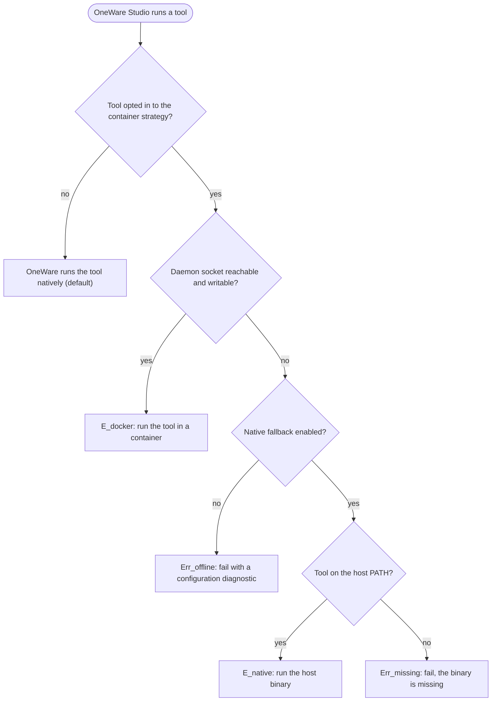

<!--
SPDX-FileCopyrightText: 2026 Mert Torun
SPDX-License-Identifier: CC-BY-4.0
-->

# Design and Implementation of a Modular Architecture for the Transparent Integration of Containerized Execution Environments for Heterogeneous Open-Source Binaries in OneWare Studio

Companion repository of the Master's thesis by Mert Torun, submitted to TH Köln, Faculty of Information, Media and Electrical Engineering, in 2026. Version of record: <https://doi.org/10.57683/EPUB-3597>

[](https://doi.org/10.57683/EPUB-3597) [](LICENSES/CC-BY-4.0.txt) [](LICENSE) [](https://www.repostatus.org/#inactive)

> [!IMPORTANT]
> [`publication/Torun_Containerized_Execution_OneWare.pdf`](publication/Torun_Containerized_Execution_OneWare.pdf) is the deposited file, byte for byte (557,042 bytes, SHA-256 `f7cb839334f73d2df225a323d0d0473181055a6041cdbca8233f33a8f0c74f93`). The LaTeX sources in [`thesis/`](thesis/) at the tag `epub-3597` reproduce its text, not its bytes. After that tag the text of the thesis changes only through [`ERRATA.md`](ERRATA.md).

## Abstract

Ensuring the reproducibility of build processes poses a significant challenge in embedded systems and Field-Programmable Gate Array (FPGA) development. The reliance on complex, platform-specific binaries and toolchains (e.g., Yosys, nextpnr) frequently leads to “Environment Drift,” where builds succeed locally but fail in collaborative environments due to system inconsistencies.

To address these challenges, this thesis investigates three central Research Questions: how to establish a robust, cross-platform containerization architecture across heterogeneous host operating systems (RQ1), how to seamlessly integrate these containerized environments into a modern IDE to preserve a native user experience (RQ2), and what performance overhead is introduced by containerized execution and architecture emulation (RQ3). To resolve these questions, a modular software integration architecture is designed and implemented as a standalone extension for the OneWare Studio IDE. Using C# and .NET 10, a decoupled middleware is developed based on a Hybrid Strategy Pattern, enabling developers to switch seamlessly between high-performance native execution and hermetic containerized workflows at runtime.

The architecture resolves critical barriers to adoption through four technical contributions—three addressing the research questions directly, complemented by a reproducibility feature:

1. Cross-Platform Interoperability (Addressing RQ1): A dynamic User-ID injection strategy and abstract transport resolution ensure seamless operation across Windows, Linux, and macOS, specifically solving file-permission locking issues on Linux systems.

2. Transparent Integration (Addressing RQ2): Real-time stream multiplexing and log-level parsing transform raw container output into structured IDE feedback, preserving the native user experience.

3. Performance Characterization (Addressing RQ3): The system exposes a user-selectable image platform so that, on ARM64 Apple Silicon, an x86 toolchain image is executed through the host runtime’s Rosetta 2 translation layer; the resulting execution overhead is characterized and decomposed.

4. Temporal Reproducibility (“Time Machine”): A dynamic tagging mechanism lets projects pin a specific toolchain image tag (optionally a content digest), providing a reproducible build environment over time.

The empirical evaluation characterizes the cost of the containerized path rather than asserting a single headline factor. Beyond raw containerization, the extension’s strategy dispatch adds a fixed per-invocation cost on the order of 0.2 s and negligible marginal compute overhead, so its relative cost is dominated by a constant floor that amortizes as workload size grows. On Apple Silicon the toolchain image runs under Rosetta 2 emulation, so a native-versus-container comparison on that host would conflate containerization with instruction-set emulation; native x86_64 hosts (Windows and Linux) reproduce the same fixed-floor structure without emulation, and the same-build native baseline on the Linux host—the one setting that isolates the container-versus-native factor—fixes it at α ≈ 1, a fixed per-invocation floor with no measurable per-instruction tax. Across the seven-workload FPGA corpus (iCE40 and ECP5 synthesis, place-and-route and bitstream packing, plus Icarus Verilog simulation) every workload executed to success through the hermetic container, so the system eliminates configuration friction and makes toolchain execution independent of the host’s package environment, resolving cascading dependency conflicts.

Keywords, as printed on p. iv: FPGA Toolchains; Docker Middleware; Hybrid Strategy Pattern; Reproducible Builds; Cross-Platform Architecture; .NET 10; Apple Silicon Emulation; User-ID Mapping; Version Pinning; Electronic Design Automation (EDA); OneWare Studio.

Corrections to the deposited thesis are listed in ERRATA.md.

### Title and abstract in other languages

<details>
<summary><span lang="de">Deutsch: Entwurf und Implementierung einer modularen Architektur zur transparenten Integration containerbasierter Ausführungsumgebungen für heterogene Open-Source-Binärdateien in OneWare Studio</span></summary>

<div lang="de">

Die Sicherstellung der Reproduzierbarkeit von Build-Prozessen stellt eine erhebliche Herausforderung in der Entwicklung eingebetteter Systeme und von Field-Programmable Gate Arrays (FPGAs) dar. Die Abhängigkeit von komplexen, plattformspezifischen Binärdateien und Toolchains (z. B. Yosys, nextpnr) führt häufig zum „Environment Drift“: Builds laufen lokal erfolgreich durch, schlagen in kollaborativen Umgebungen jedoch aufgrund von Systeminkonsistenzen fehl.

Zur Bewältigung dieser Herausforderungen untersucht diese Arbeit drei zentrale Forschungsfragen: wie sich eine robuste, plattformübergreifende Architektur zur Containerisierung über heterogene Host-Betriebssysteme hinweg etablieren lässt (RQ1), wie sich diese containerbasierten Umgebungen nahtlos in eine moderne IDE integrieren lassen, um ein natives Nutzungserlebnis zu bewahren (RQ2), und welcher Performance-Overhead durch containerbasierte Ausführung und Architekturemulation entsteht (RQ3). Zur Beantwortung dieser Fragen wird eine modulare Software-Integrationsarchitektur entworfen und als eigenständige Erweiterung für die IDE OneWare Studio implementiert. Unter Verwendung von C# und .NET 10 wird eine entkoppelte Middleware auf Basis eines hybriden Strategiemusters (Hybrid Strategy Pattern) entwickelt, die es Entwicklern ermöglicht, zur Laufzeit nahtlos zwischen leistungsstarker nativer Ausführung und hermetischen containerbasierten Arbeitsabläufen zu wechseln.

Vier technische Beiträge der Architektur beseitigen kritische Hürden für ihre Einführung; drei davon gehen unmittelbar auf die Forschungsfragen ein, der vierte ist eine ergänzende Funktion zur Reproduzierbarkeit:

1. Plattformübergreifende Interoperabilität (zu RQ1): Eine dynamische Strategie zur Injektion der User-ID und eine abstrahierte Auflösung des Transportwegs gewährleisten einen nahtlosen Betrieb unter Windows, Linux und macOS und lösen insbesondere Sperrprobleme durch Dateiberechtigungen auf Linux-Systemen.

2. Transparente Integration (zu RQ2): Echtzeit-Stream-Multiplexing und das Parsen der Log-Level überführen die rohe Container-Ausgabe in strukturierte Rückmeldungen in der IDE und bewahren so das native Nutzungserlebnis.

3. Performance-Charakterisierung (zu RQ3): Das System stellt eine vom Nutzer wählbare Image-Plattform bereit, sodass auf Apple Silicon (ARM64) ein x86-Toolchain-Image über die Rosetta-2-Übersetzungsschicht der Host-Laufzeitumgebung ausgeführt wird; der daraus resultierende Ausführungs-Overhead wird charakterisiert und aufgeschlüsselt.

4. Zeitliche Reproduzierbarkeit („Time Machine“): Ein dynamischer Tagging-Mechanismus erlaubt es Projekten, ein bestimmtes Toolchain-Image-Tag (optional einen Content-Digest) festzuschreiben, und stellt so eine über die Zeit reproduzierbare Build-Umgebung bereit.

Die empirische Evaluation charakterisiert die Kosten des containerbasierten Pfads, statt sie auf einen einzigen plakativen Faktor zu verkürzen. Über die reine Containerisierung hinaus verursacht der Strategie-Dispatch der Erweiterung feste Kosten pro Aufruf in der Größenordnung von 0,2 s und einen vernachlässigbaren marginalen Rechen-Overhead, sodass die relativen Kosten des Dispatchs von einer konstanten Untergrenze dominiert werden, die sich mit wachsender Größe des Workloads amortisiert. Auf Apple Silicon läuft das Toolchain-Image unter Rosetta-2-Emulation, sodass ein Vergleich zwischen nativer und containerbasierter Ausführung auf diesem Host die Containerisierung mit der Emulation des Befehlssatzes vermengen würde; native x86_64-Hosts (Windows und Linux) reproduzieren ohne Emulation dieselbe Struktur einer festen Untergrenze. Die native Referenzmessung desselben Builds auf dem Linux-Host ist die einzige Konstellation, die den Faktor zwischen containerbasierter und nativer Ausführung isoliert, und beziffert ihn auf α ≈ 1: eine feste Untergrenze pro Aufruf ohne messbaren Aufschlag pro Maschinenbefehl. Alle sieben Workloads des FPGA-Korpus (iCE40- und ECP5-Synthese, Place-and-Route und Bitstream-Packing sowie Simulation mit Icarus Verilog) liefen im hermetischen Container erfolgreich durch; das System beseitigt damit Reibungsverluste bei der Konfiguration und macht die Ausführung der Toolchain unabhängig von der Paketumgebung des Hosts, wodurch sich kaskadierende Abhängigkeitskonflikte auflösen.

</div>

_As published in the catalogue record (https://doi.org/10.57683/EPUB-3597), supplied by the author in 2026; not part of the deposited PDF. The English abstract of the deposited thesis is authoritative._

</details>

<details>
<summary><span lang="fr">Français: Conception et mise en œuvre d’une architecture modulaire d’intégration transparente des environnements d’exécution conteneurisés pour les binaires open source hétérogènes dans OneWare Studio</span></summary>

<div lang="fr">

Garantir la reproductibilité des processus de construction constitue un défi important dans le développement de systèmes embarqués et de circuits intégrés prédiffusés programmables (FPGA). Le recours à des binaires et des chaînes d’outils complexes et spécifiques à une plateforme (par exemple Yosys, nextpnr) conduit fréquemment à l’« Environment Drift », où les constructions aboutissent localement mais échouent dans les environnements collaboratifs en raison d’incohérences entre systèmes.

Pour relever ces défis, ce mémoire examine trois questions de recherche centrales : comment établir une architecture de conteneurisation robuste et multiplateforme sur des systèmes d’exploitation hôtes hétérogènes (RQ1), comment intégrer de manière fluide ces environnements conteneurisés dans un IDE moderne afin de préserver une expérience utilisateur native (RQ2) et quel surcoût de performance est induit par l’exécution conteneurisée et l’émulation d’architecture (RQ3). Pour répondre à ces questions, une architecture modulaire d’intégration logicielle est conçue et mise en œuvre sous la forme d’une extension autonome pour l’IDE OneWare Studio. À l’aide de C# et de .NET 10, un intergiciel découplé, fondé sur un patron de stratégie hybride (Hybrid Strategy Pattern), est développé ; il permet aux développeurs de basculer de manière fluide, à l’exécution, entre une exécution native à hautes performances et des flux de travail conteneurisés hermétiques.

L’architecture lève des obstacles majeurs à l’adoption grâce à quatre contributions techniques, dont trois répondent directement aux questions de recherche, la quatrième apportant en complément une fonctionnalité de reproductibilité :

1. Interopérabilité multiplateforme (en réponse à RQ1) : une stratégie dynamique d’injection de l’identifiant d’utilisateur et une résolution abstraite du transport garantissent un fonctionnement fluide sous Windows, Linux et macOS, en corrigeant notamment les problèmes de verrouillage des droits d’accès aux fichiers sur les systèmes Linux.

2. Intégration transparente (en réponse à RQ2) : le multiplexage en temps réel des flux et l’analyse des niveaux de journalisation transforment la sortie brute du conteneur en retours structurés au sein de l’IDE, préservant l’expérience utilisateur native.

3. Caractérisation des performances (en réponse à RQ3) : le système permet à l’utilisateur de choisir la plateforme de l’image, de sorte que, sur ARM64 Apple Silicon, une image de chaîne d’outils x86 est exécutée via la couche de traduction Rosetta 2 du moteur d’exécution hôte ; le surcoût d’exécution qui en résulte est caractérisé et décomposé.

4. Reproductibilité temporelle (« Time Machine ») : un mécanisme d’étiquetage dynamique permet aux projets de figer une étiquette précise de l’image de la chaîne d’outils (éventuellement une empreinte de contenu), fournissant ainsi un environnement de construction reproductible au fil du temps.

L’évaluation empirique caractérise le coût de la voie conteneurisée plutôt que de le ramener à un facteur unique et accrocheur. Au-delà de la conteneurisation brute, l’aiguillage de l’extension entre les stratégies ajoute un coût fixe par invocation de l’ordre de 0,2 s et un surcoût marginal de calcul négligeable, si bien que son coût relatif est dominé par un plancher constant qui s’amortit à mesure que la taille de la charge de travail augmente. Sur Apple Silicon, l’image de chaîne d’outils s’exécute sous émulation Rosetta 2, de sorte qu’une comparaison natif/conteneur sur cet hôte confondrait conteneurisation et émulation du jeu d’instructions ; les hôtes x86_64 natifs (Windows et Linux) reproduisent la même structure de plancher fixe sans émulation. La référence native pour la même construction sur l’hôte Linux est la seule configuration expérimentale qui isole le facteur conteneur/natif ; elle le situe à α ≈ 1, soit un plancher fixe par invocation sans pénalité mesurable par instruction. Sur l’ensemble du corpus FPGA de sept charges de travail (synthèse pour iCE40 et ECP5, placement-routage et empaquetage du bitstream, ainsi que simulation sous Icarus Verilog), chaque charge de travail s’est exécutée avec succès dans le conteneur hermétique, de sorte que le système élimine les difficultés de configuration et rend l’exécution de la chaîne d’outils indépendante de l’environnement de paquets de l’hôte, résolvant les conflits de dépendances en cascade.

</div>

_As published in the catalogue record (https://doi.org/10.57683/EPUB-3597), supplied by the author in 2026; not part of the deposited PDF. The English abstract of the deposited thesis is authoritative._

</details>

<details>
<summary><span lang="tr">Türkçe: Heterojen Açık Kaynaklı İkili Dosyalara Yönelik Konteynerleştirilmiş Yürütme Ortamlarının OneWare Studio'ya Saydam Entegrasyonu İçin Modüler Bir Mimarinin Tasarımı ve Gerçeklenmesi</span></summary>

<div lang="tr">

Derleme (build) süreçlerinin yeniden üretilebilirliğinin güvence altına alınması, gömülü sistem ve Sahada Programlanabilir Kapı Dizisi (FPGA) geliştirmede önemli bir zorluk oluşturmaktadır. Karmaşık, platforma özgü ikili dosyalara ve araç zincirlerine (örneğin Yosys, nextpnr) bağımlılık, derlemelerin geliştiricinin kendi makinesinde başarılı olduğu ancak sistem tutarsızlıkları nedeniyle iş birliğine dayalı ortamlarda başarısız olduğu “Ortam Kayması” (Environment Drift) durumuna sıklıkla yol açmaktadır.

Bu zorlukları ele almak üzere bu tez, üç merkezî araştırma sorusunu incelemektedir: heterojen ana makine işletim sistemleri genelinde sağlam ve platformlar arası bir konteynerleştirme mimarisinin nasıl kurulacağı (RQ1), yerel (native) kullanıcı deneyimini korumak üzere bu konteynerleştirilmiş ortamların modern bir IDE'ye nasıl sorunsuz biçimde entegre edileceği (RQ2) ve konteynerleştirilmiş yürütmenin ve mimari emülasyonunun ne ölçüde bir performans ek yükü getirdiği (RQ3). Bu soruları yanıtlamak amacıyla, modüler bir yazılım entegrasyonu mimarisi OneWare Studio IDE'si için bağımsız bir eklenti olarak tasarlanmış ve gerçeklenmiştir. C# ve .NET 10 kullanılarak, Hibrit Strateji Deseni (Hybrid Strategy Pattern) temelinde gevşek bağlı bir ara katman yazılımı geliştirilmiş, böylece geliştiricilerin çalışma zamanında yüksek performanslı yerel yürütme ile hermetik konteynerleştirilmiş iş akışları arasında sorunsuz biçimde geçiş yapabilmesi olanaklı kılınmıştır.

Mimari, benimsenmenin önündeki kritik engelleri dört teknik katkı aracılığıyla ortadan kaldırmaktadır; bunların üçü araştırma sorularını doğrudan ele almakta, bu üçüne bir yeniden üretilebilirlik özelliği eşlik etmektedir:

1. Platformlar Arası Birlikte Çalışabilirlik (RQ1'i ele alır): Dinamik bir kullanıcı kimliği (User-ID) enjeksiyonu stratejisi ve soyut taşıma belirlemesi, Windows, Linux ve macOS genelinde sorunsuz çalışmayı güvence altına almakta, özellikle Linux sistemlerindeki dosya izni kilitlenmesi sorunlarını çözmektedir.

2. Saydam Entegrasyon (RQ2'yi ele alır): Gerçek zamanlı akış çoğullaması ve günlük düzeyi (log level) ayrıştırması, ham konteyner çıktısını yapılandırılmış IDE geri bildirimine dönüştürerek yerel kullanıcı deneyimini korumaktadır.

3. Performans Karakterizasyonu (RQ3'ü ele alır): Sistem, kullanıcı tarafından seçilebilen bir imaj platformu sunmakta, böylece ARM64 Apple Silicon üzerinde bir x86 araç zinciri imajı, ana makine çalışma zamanının Rosetta 2 çeviri katmanı üzerinden yürütülmektedir; ortaya çıkan yürütme ek yükü karakterize edilmekte ve bileşenlerine ayrıştırılmaktadır.

4. Zamansal Yeniden Üretilebilirlik (“Zaman Makinesi”, Time Machine): Dinamik bir etiketleme mekanizması, projelerin belirli bir araç zinciri imajı etiketini, isteğe bağlı olarak bir içerik özetini (content digest), sabitlemesine olanak tanıyarak zaman içinde yeniden üretilebilir bir derleme ortamı sağlamaktadır.

Ampirik değerlendirme, tek bir toplu çarpan değeri ileri sürmek yerine konteynerleştirilmiş yolun maliyetini karakterize etmektedir. Salt konteynerleştirmenin ötesinde, eklentinin strateji gönderimi çağrı başına 0,2 s mertebesinde sabit bir maliyet ve ihmal edilebilir düzeyde marjinal hesaplama ek yükü eklemekte, dolayısıyla göreli maliyetinde, iş yükü boyutu büyüdükçe amortize olan sabit bir taban baskın olmaktadır. Apple Silicon üzerinde araç zinciri imajı Rosetta 2 emülasyonu altında çalıştığından, bu ana makinede yerel ile konteyner arasında karşılaştırma yapmak, konteynerleştirmeyi komut kümesi emülasyonuyla birbirine karıştırmak anlamına gelirdi; yerel x86_64 ana makineleri (Windows ve Linux) ise aynı sabit taban yapısını emülasyon olmaksızın yeniden üretmektedir. Linux ana makinesindeki aynı derlemeye ait yerel temel ölçüm, konteynerin yerele göre çarpanını yalıtan tek ölçüm düzenidir ve bu çarpanı α ≈ 1 olarak belirlemektedir; bu, komut başına ölçülebilir bir ek maliyet içermeyen, çağrı başına sabit bir tabandır. Yedi iş yükünden oluşan FPGA kümesinde (iCE40 ve ECP5 sentezi, yerleştirme ve yönlendirme ile bit akışı paketlemesi, ayrıca Icarus Verilog simülasyonu) her iş yükü hermetik konteyner üzerinden başarıyla yürütülmüştür; böylece sistem, yapılandırma zahmetini ortadan kaldırmakta ve araç zinciri yürütmesini ana makinenin paket ortamından bağımsız kılmakta, bu da zincirleme bağımlılık çakışmalarını çözmektedir.

</div>

_As published in the catalogue record (https://doi.org/10.57683/EPUB-3597), supplied by the author in 2026; not part of the deposited PDF. The English abstract of the deposited thesis is authoritative. The record lists this language as mul._

</details>

<details>
<summary><span lang="es">Español: Diseño e implementación de una arquitectura modular para la integración transparente de entornos de ejecución en contenedores destinados a binarios de código abierto heterogéneos en OneWare Studio</span></summary>

<div lang="es">

Garantizar la reproducibilidad de los procesos de compilación constituye un reto considerable en el desarrollo de sistemas empotrados y de matrices de puertas programables en campo (FPGA). La dependencia de binarios y cadenas de herramientas complejos y específicos de cada plataforma (por ejemplo, Yosys o nextpnr) conduce con frecuencia a la denominada «Environment Drift», en la que las compilaciones funcionan localmente pero fallan en entornos colaborativos debido a inconsistencias entre sistemas.

Para abordar estos retos, este trabajo examina tres preguntas de investigación centrales: cómo establecer una arquitectura de contenerización robusta y multiplataforma sobre sistemas operativos anfitriones heterogéneos (RQ1), cómo integrar de forma fluida en un IDE moderno estos entornos en contenedores para preservar una experiencia de usuario nativa (RQ2) y qué sobrecarga de rendimiento introducen la ejecución en contenedores y la emulación de arquitectura (RQ3). Para resolver estas cuestiones, se diseña e implementa una arquitectura modular de integración de software como extensión autónoma para el IDE OneWare Studio. Mediante C# y .NET 10 se desarrolla un middleware desacoplado, basado en un patrón de estrategia híbrido (Hybrid Strategy Pattern), que permite a los desarrolladores alternar sin fisuras, en tiempo de ejecución, entre una ejecución nativa de alto rendimiento y flujos de trabajo herméticos en contenedores.

La arquitectura elimina barreras críticas para la adopción mediante cuatro aportaciones técnicas: tres responden directamente a las preguntas de investigación y se complementan con una funcionalidad de reproducibilidad.

1. Interoperabilidad multiplataforma (responde a RQ1): una estrategia dinámica de inyección del identificador de usuario y una resolución abstracta del transporte garantizan un funcionamiento fluido en Windows, Linux y macOS, y resuelven en particular los bloqueos por permisos de archivo en sistemas Linux.

2. Integración transparente (responde a RQ2): la multiplexación de flujos en tiempo real y el análisis del nivel de registro convierten la salida bruta del contenedor en retroalimentación estructurada en el IDE y preservan la experiencia de usuario nativa.

3. Caracterización del rendimiento (responde a RQ3): el sistema ofrece una plataforma de imagen seleccionable por el usuario, de modo que en Apple Silicon (ARM64) una imagen de cadena de herramientas x86 se ejecuta a través de la capa de traducción Rosetta 2 del entorno de ejecución del anfitrión; la sobrecarga de ejecución resultante se caracteriza y se descompone.

4. Reproducibilidad temporal («Time Machine»): un mecanismo dinámico de etiquetado permite a los proyectos fijar una etiqueta concreta de la imagen de la cadena de herramientas, opcionalmente un resumen de contenido, lo que proporciona un entorno de compilación reproducible a lo largo del tiempo.

La evaluación empírica caracteriza el coste de la vía basada en contenedores en lugar de reducirlo a un único factor llamativo. Más allá de la contenerización propiamente dicha, el despacho de estrategias de la extensión añade un coste fijo por invocación del orden de 0,2 s y una sobrecarga marginal de cómputo despreciable, de modo que su coste relativo está dominado por un suelo constante que se amortiza a medida que crece el tamaño de la carga de trabajo. En Apple Silicon la imagen de la cadena de herramientas se ejecuta bajo emulación Rosetta 2, por lo que una comparación entre ejecución nativa y ejecución en contenedor sobre ese anfitrión confundiría la contenerización con la emulación del juego de instrucciones; los anfitriones x86_64 nativos (Windows y Linux) reproducen la misma estructura de suelo fijo sin emulación. La medición de referencia nativa de la misma compilación en el anfitrión Linux es el único escenario que aísla el factor entre contenedor y ejecución nativa, y lo sitúa en α ≈ 1: un suelo fijo por invocación, sin coste medible por instrucción. En el corpus FPGA de siete cargas de trabajo (síntesis para iCE40 y ECP5, emplazamiento y enrutado, empaquetado del flujo de bits y simulación con Icarus Verilog), todas las cargas se ejecutaron con éxito a través del contenedor hermético; así, el sistema elimina la fricción de configuración e independiza la ejecución de la cadena de herramientas del entorno de paquetes del anfitrión, con lo que resuelve los conflictos de dependencias en cascada.

</div>

_As published in the catalogue record (https://doi.org/10.57683/EPUB-3597), supplied by the author in 2026; not part of the deposited PDF. The English abstract of the deposited thesis is authoritative._

</details>

## Publication

| Field | Value |
| --- | --- |
| Type | Master's thesis |
| Institution | TH Köln (Technische Hochschule Köln) |
| Faculty | Faculty of Information, Media and Electrical Engineering (F07) |
| Institute | Institute of Computer and Communication Technology (ICCT), as the catalogue record names it; the thesis names no institute |
| Programme | Computer Science & Engineering (Technische Informatik), M.Sc. |
| Supervisors | Prof. Dr. Tobias Krawutschke; M.Sc. Sebastian Wittlich, as the title page prints them |
| Submitted | 2026-07-02 |
| Examined | 2026-08-19 |
| Published | 2026-09-15, open access on ePublications, a publication server of TH Köln |
| DOI | <https://doi.org/10.57683/EPUB-3597> |
| URN | [urn:nbn:de:hbz:832-epub4-35974](https://nbn-resolving.org/urn:nbn:de:hbz:832-epub4-35974) |
| Licence | CC BY 4.0; the mark of TH Köln on the title page excepted, see [`NOTICE`](NOTICE) |
| Language | English |
| Pages | 91; the PDF has 106 pages |
| Classification | DDC 004 (Data processing & computer science) and 621.3 (Electrical engineering, electronics); ACM CCS 1998: C.4 (Performance of Systems), D.2.6 (Programming Environments), subentry "Integrated environments", D.2.9 (Management) and D.2.11 (Software Architectures), subentry "Domain-specific architectures" |

## Version of record

[`publication/Torun_Containerized_Execution_OneWare.pdf`](publication/Torun_Containerized_Execution_OneWare.pdf) is byte-identical with the file the catalogue record serves under the DOI above: 557,042 bytes, SHA-256 `f7cb839334f73d2df225a323d0d0473181055a6041cdbca8233f33a8f0c74f93`. The tag `epub-3597` marks the state of this repository that holds it, with LaTeX sources that reproduce its text; where the committed sources had diverged from the deposited text, they were reconciled with it in 2026 (the third item of Section 7.3 and four hyphens in Chapter 6). [`publication/README.md`](publication/README.md) states how the deposited file differs from the thesis as submitted for examination, and gives the ways to verify the file, with and without a GitHub account.

## The work in brief

OneWare Studio is an IDE for FPGA development built on .NET 10 and Avalonia (Section 3.1). It runs open-source toolchains such as Yosys, nextpnr and Icarus Verilog natively on the host, so a build that succeeds on one machine can fail on another, which the thesis calls "Environment Drift" (Section 1.1). Containers pin a toolchain, but driving them from a command line breaks the work in the IDE (Section 1.2). The thesis designs and implements an extension for OneWare Studio that runs selected tools in containers, transparently for the user, and measures what that costs. Its three research questions (Section 1.3):

- **RQ1, architectural foundation:** which architectural patterns make container orchestration work across Windows, Linux and macOS, including user-ID mapping and the transports to the daemon (Chapter 4, Section 5.3);
- **RQ2, transparent integration:** how the containerized tools can be integrated into a .NET IDE with streamed output and structured diagnostics (Sections 4.3, 5.4 and 5.9); assessed qualitatively;
- **RQ3, performance viability:** what the containerized path costs against native execution, also across architectures (Chapter 6).

### Contributions

| Contribution, as the abstract names it | RQ | Thesis | Code at `5fa2f5f`, in `FEntwumS.ContainerExtension/src/ContainerExtension/` |
| --- | --- | --- | --- |
| Cross-platform interoperability: host user and group ID injection, transport resolution | RQ1 | 4.2, 5.3 | `DockerExecutionStrategy.cs` (transport resolution, named-pipe credentials), `Services/Docker/DockerCommandBuilder.cs` (container user, hardening defaults) |
| Transparent integration: stream demultiplexing and log parsing | RQ2 | 4.3, 5.4, 5.9 | `DockerExecutionStrategy.cs`, `Services/Docker/DockerContainerManager.cs`, `ContainerTelemetry.cs`, `ContainerExtensionModule.cs` |
| Performance characterization: a user-selectable image platform, and the measured overhead | RQ3 | 5.2.1, 6.4, 6.5 | `DockerExecutionStrategy.cs` (platform setting); [`evaluation/`](evaluation/) of this repository |
| Temporal reproducibility ("Time Machine"): pinned toolchain image tags and registry tag discovery | none | 5.8 | `Registry/RegistryClient.cs`, `Services/Docker/DockerImageManager.cs` |

The code at the pinned commit `5fa2f5f` was written by the author for this thesis, apart from three automated dependency updates; later upstream changes, including those by other contributors, are not part of it. Measured on 2026-10-02: 175 commits are reachable from `5fa2f5f` (2026-04-10 to 2026-07-02), 172 by the author under two e-mail identities and three automated dependency updates, and none carries a co-author trailer. The pinned commit is the state of the extension when the thesis was submitted, not the state the measurements ran on; [`evaluation/README.md`](evaluation/README.md#provenance-of-the-results) names the measured states.

### Routing of a tool invocation

Container routing is opt-in per tool: OneWare dispatches only the tools a user has opted in to the container strategy, and runs all others natively, as by default (Section 4.1). For an opted-in tool, the strategy chooses the execution by Equation (4.1), where $S_{\mathrm{dock}}$ is 1 when the daemon socket is reachable and writable, $C_{\mathrm{fallback}}$ is 1 when native fallback is enabled (setting `ContainerExtension_AllowNativeFallback`), and $P_{\mathrm{native}}$ is 1 when the tool is on the host `PATH`:

```math
E = f(S_{\mathrm{dock}}, C_{\mathrm{fallback}}, P_{\mathrm{native}}) =
\begin{cases}
E_{\mathrm{docker}} & \text{if } S_{\mathrm{dock}} = 1 \\
E_{\mathrm{native}} & \text{if } S_{\mathrm{dock}} = 0 \land C_{\mathrm{fallback}} = 1 \land P_{\mathrm{native}} = 1 \\
\mathrm{Err}_{\mathrm{offline}} & \text{if } S_{\mathrm{dock}} = 0 \land C_{\mathrm{fallback}} = 0 \\
\mathrm{Err}_{\mathrm{missing}} & \text{if } S_{\mathrm{dock}} = 0 \land C_{\mathrm{fallback}} = 1 \land P_{\mathrm{native}} = 0
\end{cases}
```



The same routing as text: a tool that is not opted in runs natively. An opted-in tool runs in a container when the daemon is reachable. When it is not, the invocation fails with a daemon-offline diagnostic if fallback is disabled; with fallback enabled, the tool runs on the host if it is on the `PATH`, and the invocation fails with a missing-binary diagnostic otherwise.

### Transports and runtimes

The extension talks to the Docker Engine API directly (Section 5.1.2) and resolves the endpoint in this order (Section 4.2.1, Figure 4.2):

| Step | Host | Endpoint |
| --- | --- | --- |
| 1 | any | A custom socket (setting `ContainerExtension_DaemonSocket`) or `DOCKER_HOST`: `unix`, `npipe`, `tcp`, `http(s)` or `ssh` |
| 2 | Windows | The named pipe `\\.\pipe\docker_engine`, opened at `TokenImpersonationLevel.Identification` (Section 5.3); an optional check of the pipe server, off by default (Appendix B.3.2) |
| 2 | macOS, Linux | Unix sockets in an ownership-checked order: `/var/run/docker.sock`, then the rootless Podman socket `/run/user/<UID>/podman/podman.sock`, then Colima and OrbStack |

The evaluation used one runtime per host: OrbStack on Machine 1 (macOS), Docker Engine on Machine 2 (Linux) and Docker Desktop with the WSL2 backend on Machine 3 (Windows) (Section 6.2.1). Appendix B also describes rootless Podman, which the evaluation did not measure.

### Principal results

Each result holds for the corpus, the hosts and the runtimes the thesis measured; [`evaluation/README.md`](evaluation/README.md#claims-and-their-evidence) gives the evidence of each.

- **Output determinism.** The six FPGA artifacts of the corpus, iCE40 and ECP5 synthesis, place-and-route and bitstream packing, were byte-identical on the three machines, one ARM64 host running the amd64 image under emulation and two x86_64 hosts; the simulation artifact `Blink.vvp` differs from run to run because Icarus Verilog names objects after heap addresses, and is excluded (Section 6.5.3, Table 6.4).
- **Marginal cost of the extension.** Over raw `docker run`, the extension adds a fixed per-invocation cost and no cost that grows with the work: the mean strategy-minus-CLI difference over the FPGA workloads is about 0.18 s on Machine 1, 0.21 s on Machine 2 and 0.23 s on Machine 3, the last without the bimodal `pnr_ice40_nextpnr` run, close to the difference of a no-op container invocation (Sections 6.4.1 to 6.4.3; [`ERRATA.md`](ERRATA.md), E-019).
- **Container against native.** On Machine 2, whose native toolchain is the same build as the image, the additive container floor stays between 0.258 s and 0.327 s while the native work ranges from 16 ms to 0.51 s: the multiplier α of native compute is about 1 there (Sections 6.4.2 and 6.5.1).
- **Emulation.** On Machine 1 the amd64 image runs under Rosetta 2, so no native baseline was taken and α is not measured for emulation; the thesis cites a penalty of the hardware TSO mode from the literature (Section 6.5.1; E-021 and E-032).

### Security design properties

The thesis states these as design properties of the architecture; a threat-model analysis of them is out of its scope (Section 4.4).

- **Non-root execution.** On rootful runtimes the container runs as the host user (`--user` with the host UID:GID), so build artifacts belong to the developer; on rootless runtimes the runtime's own user-namespace remap applies and `--user` is omitted.
- **Reduced kernel surface.** All Linux capabilities are dropped, `no-new-privileges` is set and the process count is capped; the runtime's default seccomp profile applies.
- **Workspace path containment.** Bind-mount paths are canonicalized segment by segment, with cycle detection and a bounded depth; a path outside the workspace root is not mounted. A time-of-check to time-of-use window remains (Section 4.4).
- **Shell-less execution.** Commands run as an argument vector with `tini` as PID 1, so shell metacharacters are inert; a secondary check rejects arguments that embed command separators (Sections 4.4 and 5.7; E-030).
- **Windows transport.** The named-pipe client requests the impersonation level Identification, so a daemon endpoint can identify the client but cannot act on its behalf (Section 5.3).
- **Resource bounds.** CPU, memory and process-count limits apply through the runtime's cgroup controls.

The extension is built with `IsAotCompatible` set and uses explicit reflection at one documented place: it replaces the stream opener of the Windows named-pipe transport through a private field of the Docker.DotNet library, because the public API cannot express the lower impersonation level (Section 5.3.1; `DockerExecutionStrategy.cs`, lines 1162 to 1186 at `5fa2f5f`). That count covers explicit reflection calls only: Docker.DotNet serializes through Newtonsoft.Json, which one view model of the extension uses as well, and the extension preserves both assemblies from trimming. No Native-AOT build was tested in the thesis ([`ERRATA.md`](ERRATA.md), E-015).

## Contents

| Path | Content | In the thesis | Licence |
| --- | --- | --- | --- |
| [`publication/`](publication/) | The deposited thesis, its checksum and how to verify it | the whole thesis | CC BY 4.0; the mark of TH Köln excepted |
| [`thesis/`](thesis/) | The LaTeX sources; `thesis/figures/th_logo.pdf` is the mark of TH Köln | the whole thesis | CC BY 4.0; the mark excepted |
| [`evaluation/`](evaluation/) | Benchmark harness, evaluation scripts, raw results and tables of the three machines, the original files of the cross-host control of Section 6.5.3, workload designs, supplementary examples; its [`README.md`](evaluation/README.md) maps each number of Chapter 6 to its evidence | Chapter 6 | MIT for code, CC BY 4.0 for data and documentation; six fixtures excepted |
| `FEntwumS.ContainerExtension/` | The extension under study, as a pinned submodule | Chapters 4 and 5, Appendices A and B | its own: MIT |
| `OneWare/`, `OneWare.GhdlExtension/`, `FEntwumS.NetlistViewer/` | OneWare Studio and two of its extensions, as pinned submodules for reference | Section 3.1 | their own |
| [`scripts/`](scripts/) | Comparison of a build with the deposited text, reproduction of the result statistics from the raw times, checks of the metadata and of the links | not in the thesis | MIT |
| [`docs/social/`](docs/social/) | The social card of this repository and the script that renders it | not in the thesis | CC BY 4.0; the script MIT |
| [`ERRATA.md`](ERRATA.md), [`CHANGELOG.md`](CHANGELOG.md), [`NOTICE`](NOTICE), [`CITATION.cff`](CITATION.cff), [`codemeta.json`](codemeta.json) | Errata, changes, licences and credits, citation metadata | not in the thesis | CC BY 4.0 |
| [`Makefile`](Makefile), [`.github/`](.github/) | Build and checks, workflows, the correction form | not in the thesis | MIT |

### Paths named in the thesis

The thesis names files by their paths in the repository of the extension, where the evaluation apparatus lived until 2026-06-30:

| In the thesis | In this repository |
| --- | --- |
| `src/ContainerExtension/` (Table A.1, Listing C.1) | `FEntwumS.ContainerExtension/src/ContainerExtension/`, in the submodule |
| `src/ContainerBenchmarkHarness/Program.cs` (Section 6.3, Listing C.1) | [`evaluation/harness/Program.cs`](evaluation/harness/Program.cs) |
| `benchmark.py`, `run_evaluation.py` (Section 6.3) | [`evaluation/benchmarking_suite/`](evaluation/benchmarking_suite/) |
| the extension "on the main branch" (Appendix A) | the submodule `FEntwumS.ContainerExtension` at `5fa2f5f`, its state when the thesis was submitted |

## Pinned software

The four submodules are pinned at their state when the thesis was submitted and are not moved. The note of the catalogue record names this repository as the place of the source code of the extension and of the evaluation data; the source code is here as the submodule `FEntwumS.ContainerExtension`.

| Submodule | Upstream | Commit | Date | Role | Licence, as its licence file states it |
| --- | --- | --- | --- | --- | --- |
| `FEntwumS.ContainerExtension` | <https://github.com/FEntwumS/FEntwumS.ContainerExtension> | `5fa2f5f` | 2026-07-02 | Required: the extension under study. One commit after release 1.0.10, which changes only the marketplace manifest. The harness references its project, and the toolchain image is built from its `docker/` folder | MIT, Mert Torun |
| `OneWare` | <https://github.com/FEntwumS/OneWare> | `a3a5a79` | 2026-06-25 | Reference: OneWare Studio at the time of the thesis | GNU GPL version 3 for the repository; the package `OneWare.Essentials`, which the harness uses, declares MIT |
| `OneWare.GhdlExtension` | <https://github.com/FEntwumS/OneWare.GhdlExtension> | `01d1406` | 2026-03-26 | Reference: the GHDL extension of OneWare Studio | MIT for the extension, Protop Solutions UG; the GNU GPL version 2 its licence file names applies to GHDL itself, which the submodule does not contain |
| `FEntwumS.NetlistViewer` | <https://github.com/FEntwumS/FEntwumS.NetlistViewer> | `2ef4d51` | 2026-06-26 | Reference: the netlist viewer extension | MIT, TH Koeln |

A clone with all four submodules, and a clone with only the one the harness and the image build need:

```sh
git clone --recurse-submodules https://github.com/mtorun0x7cd/thesis-fentwums-container-extension.git

git clone https://github.com/mtorun0x7cd/thesis-fentwums-container-extension.git
cd thesis-fentwums-container-extension
git submodule update --init FEntwumS.ContainerExtension
```

The submodules are fetched at their pinned commit only (`.gitmodules` sets `shallow = true`); `git -C FEntwumS.ContainerExtension fetch --unshallow` adds the history, for example to recount the commits above or to read the upstream commit `1884317` of the macOS measurement. The source archives that GitHub generates contain no submodules.

## Reproducing

### The thesis

With TeX Live (LuaLaTeX, Biber, latexmk and ChkTeX):

```sh
make thesis           # writes build/thesis/main.pdf
make verify-deposit   # checks publication/ against SHA256SUMS and compares the text of the build with the deposited file
make check            # runs ChkTeX over the sources
```

The build date is fixed to the creation date of the deposited file (`SOURCE_DATE_EPOCH=1783019135`), and a build carries the title, author, subject and keywords of the deposited file, though not its creator and producer entries. The sources reproduce the text of the deposited file, not its bytes: the deposited file was linearised, with its metadata rewritten, by a step that is not part of this repository. [`scripts/compare_pdf_text.py`](scripts/compare_pdf_text.py) compares the two texts page by page as multisets of words, which keeps a hyphen and an en dash apart. On 2026-10-02 the tag `epub-3597`, typeset twice in one directory with TeX Live 2026 on macOS, gave the same bytes both times, and its text equals that of the deposited file on all 106 pages; the PDF identifier depends on the directory a build runs in. CI typesets the thesis in the container `ghcr.io/xu-cheng/texlive-full@sha256:11383430b9a3e48c0b79339f34d8092f942f897d91ab3749d4899d06731fea7f`, twice, compares the two files byte for byte and records the TeX Live version in its log; its artifact is a build, not the version of record.

### The evaluation

The measurement needs Docker, the .NET SDK and Python 3 on three hosts; [`evaluation/README.md`](evaluation/README.md#rerunning-the-evaluation) gives the commands. In short:

1. Build the toolchain image `fentwums/oss-cad-suite:2026-06-30` with `FEntwumS.ContainerExtension/docker/build_oss_cad_suite.sh`; the Dockerfile pins the Ubuntu base image by digest and the oss-cad-suite archive of 2026-06-30 by SHA-256.
2. Publish the harness: `dotnet publish evaluation/harness/ContainerBenchmarkHarness.csproj -c Release -o evaluation/benchmarking_suite/harness_bin`.
3. Run `python3 evaluation/benchmarking_suite/run_evaluation.py --image fentwums/oss-cad-suite:2026-06-30` on each host, with `--with-native` on a Linux amd64 host whose native toolchain passes the parity check.
4. Collect the per-host results and run `python3 evaluation/benchmarking_suite/aggregate.py`.

> [!NOTE]
> The toolchain image is build-only and is not on a registry, so a rebuilt image has its own digest (Section 6.5.3). The check of a rerun is the six FPGA artifact hashes that [`evaluation/README.md`](evaluation/README.md#rerunning-the-evaluation) lists in full, not the image digest. A run took about 7 minutes on Machine 1, 16 minutes on Machine 2 with the native baseline and 10 minutes on Machine 3, without the image build.

`make aggregate-check` recomputes, without Docker, the statistics of every result file from its raw times and the committed tables from the result files: all 96 statistics and comparison blocks are reproduced, `summary.md` and `determinism.md` come out byte-identical, and `summary.csv` identical up to its line endings.

### The checks CI runs

- [`build.yml`](.github/workflows/build.yml): ChkTeX; the thesis typeset twice and compared; the deposited file against `SHA256SUMS`; then the text of the build against the deposited file.
- [`checks.yml`](.github/workflows/checks.yml): `SHA256SUMS`; `CITATION.cff` with cffconvert and against schema 1.2.0 through a plain YAML loader; `codemeta.json` expanded as JSON-LD; the agreement of `CITATION.cff`, `codemeta.json` and the BibTeX entry below; REUSE; and the links to doi.org, nbn-resolving.org and the GitHub addresses of this repository and of the pins, a check that runs on push and is not required.
- [`evaluation.yml`](.github/workflows/evaluation.yml): the statistics and tables recomputed from the raw results, the SHA-256 of `benchmark.py`, a build of the harness with the SDK of `evaluation/global.json`, and a compile of the Python scripts.
- [`docs.yml`](.github/workflows/docs.yml) lints the Markdown files; [`secret-scan.yml`](.github/workflows/secret-scan.yml) scans the history with gitleaks.

## Limitations

Threats to validity, as the thesis states them (Sections 6.1, 6.5.9 and 6.5.10):

- Machine 1 runs the amd64 image under Rosetta 2, so its figures isolate the marginal cost of the extension, not the cost of containerisation; α is isolated on Machine 2 only, because Machine 3 has no same-build native toolchain (Section 6.5.2).
- Each host ran one container runtime; the workloads are short single-tool dispatches, for which the relative overhead is large.
- The native versions of nextpnr, icepack and ecppack were not resolved by the harness; their parity rests on the shared oss-cad-suite release (Table 6.2).
- `Blink.vvp` is excluded from the determinism claim; the contention constants of Section 6.4.5 are illustrative; the penalty under emulation is cited, not measured.

Beyond these, [`evaluation/README.md`](evaluation/README.md#limits) names what is not in this repository, among it the raw log of the telemetry stress test, and that the measured code is not the pinned commit. [`ERRATA.md`](ERRATA.md) lists claims of the thesis that its evidence does not support.

Future work, as Section 7.3 of the deposited thesis lists it:

1. "Multi-Architecture OCI Registry Manifests: Optimizing cross-architecture performance on ARM64 host machines by dynamically querying OCI Registry Manifests to verify the existence of native linux/arm64 image variants before falling back to Rosetta 2 translation or QEMU emulation."
2. "Hardware-in-the-Loop (HIL) Sandboxing: Integrating USB device forwarding mechanisms (e.g., forwarding FTDI or UART devices via usbipd or native Linux device nodes) to allow programmer tools like openFPGALoader and iceprog to deploy compiled bitstreams directly onto target FPGA boards securely from within the sandbox."
3. "VIMS IEEE Telemetry Integration: Aligning the plugin’s telemetry and benchmarking engine with standardized IEEE Virtual Instrumentation and Measurement Systems formats to enable unified reporting of verification durations, success metrics, and resource footprints." No IEEE standard or format of this name could be traced ([`ERRATA.md`](ERRATA.md), E-033).

The thesis also leaves a systematic comparison of container runtimes (Section 7.2) and a dedicated threat-model analysis of the security design properties (Sections 4.4 and 7.2) to further work.

The code the thesis describes lies in the repository of another organisation, at the pinned commit, and is not archived with this repository. Development of the extension continues upstream after that commit; this repository does not track it.

The deposited PDF is untagged and declares no document language. As the version of record it cannot be changed; the abstracts, the tables and the text descriptions above are its accessible summary.

## Corrections

[`ERRATA.md`](ERRATA.md) lists the known errors of the thesis, the properties of its catalogue record and of the deposited file, and the web addresses of the thesis that no longer work or have moved. The deposited file does not change: a confirmed error is added to `ERRATA.md`, and an error that affects a result is reported to the library.

To report an error, open an issue with the form **Correction** and give the location in the thesis or the file, the quoted text, the proposed correction and the evidence. A matter that should not be public goes by e-mail to [info@mtorun0x7cd.com](mailto:info@mtorun0x7cd.com), as [`SECURITY.md`](SECURITY.md) describes. Changes of the extension itself belong upstream ([`CONTRIBUTING.md`](CONTRIBUTING.md)). [`CHANGELOG.md`](CHANGELOG.md) lists the changes of this repository.

## Citation

APA:

Torun, M. (2026). _Design and implementation of a modular architecture for the transparent integration of containerized execution environments for heterogeneous open-source binaries in OneWare Studio_ [Master's thesis, Technische Hochschule Köln]. ePublications TH Köln. <https://doi.org/10.57683/EPUB-3597>

BibTeX:

```bibtex
@mastersthesis{Torun2026,
  author = {Torun, Mert},
  title  = {Design and Implementation of a Modular Architecture for the Transparent Integration of Containerized Execution Environments for Heterogeneous Open-Source Binaries in {OneWare Studio}},
  school = {Technische Hochschule Köln},
  type   = {Master's thesis},
  year   = {2026},
  doi    = {10.57683/EPUB-3597},
  url    = {https://doi.org/10.57683/EPUB-3597},
  note   = {URN: urn:nbn:de:hbz:832-epub4-35974}
}
```

GitHub's "Cite this repository" reads [`CITATION.cff`](CITATION.cff) and renders the thesis as `@misc`, without its school; the entry above cites it as a Master's thesis.

## Related works

- [FEntwumS.ContainerExtension](https://github.com/FEntwumS/FEntwumS.ContainerExtension): the extension the thesis designs and evaluates, maintained upstream in the repository of the FEntwumS organisation; this repository pins it at `5fa2f5f`.
- [OneWare Studio](https://github.com/one-ware/OneWare): the IDE the extension integrates with (Section 3.1).

## License

| Path | Licence |
| --- | --- |
| `thesis/`, `publication/` | CC BY 4.0, the licence of the thesis; the mark of TH Köln (`thesis/figures/th_logo.pdf`, and on the title page) is excepted, see [`NOTICE`](NOTICE) |
| `evaluation/benchmarking_suite/results/` | CC BY 4.0: measured data |
| `evaluation/harness/`, the scripts and fixtures in `evaluation/`, `evaluation/examples/`, `scripts/`, `Makefile`, `.github/`, `.githooks/`, the build and configuration files, `docs/social/render.sh` | MIT |
| Six integration fixtures taken from the project templates of OneWare Studio | not licensed by this repository; [`NOTICE`](NOTICE), section 3, names them and their source |
| This README and the other documentation, `CITATION.cff`, `codemeta.json`, `docs/social/social-card.*` | CC BY 4.0 |
| The four submodules | their own licences, see [Pinned software](#pinned-software) |

[`LICENSE`](LICENSE) holds the MIT License and [`LICENSES/`](LICENSES/) the texts of the licences in use; [`REUSE.toml`](REUSE.toml) and the SPDX tags in the files give the licence of every file, and [`NOTICE`](NOTICE) gives the material of third parties, the origin of the hardware designs and the licence history.

## Contact

Mert Torun, [info@mtorun0x7cd.com](mailto:info@mtorun0x7cd.com)
